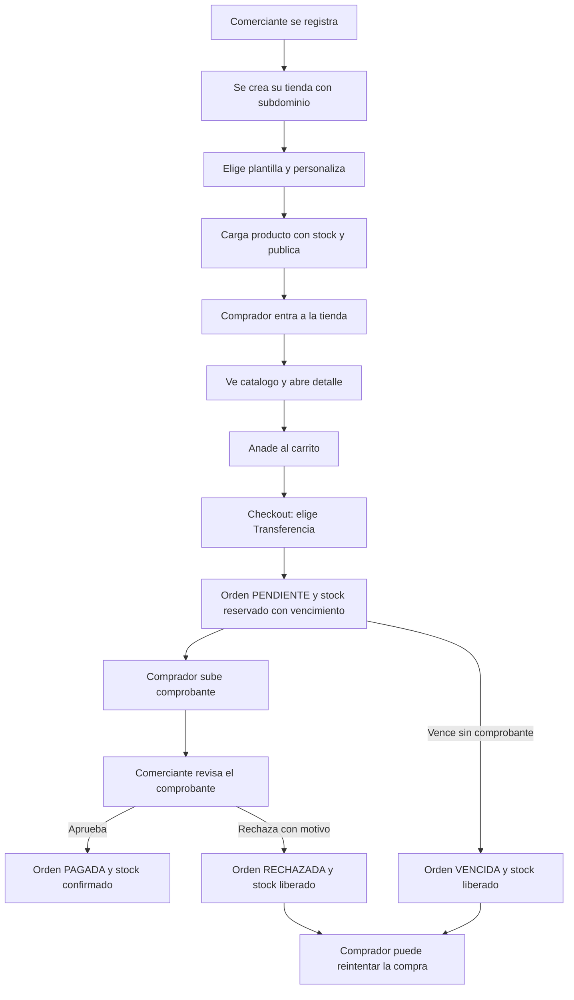

# Flujo de usuario (concepto) — Walking skeleton end-to-end

> Nivel de concepto. Fecha: 2026-11-09.
> Entradas upstream: `intent-statement` (Intent Capture), `scope-document` e `intent-backlog` (Scope Definition), de los que toma el alcance mínimo viable y el enfoque walking-skeleton.
>
> Flujo principal elegido: el walking skeleton end-to-end (comerciante crea tienda y producto; comprador compra con transferencia y comprobante; el comerciante aprueba). Se diagraman también las variantes de pago rechazado y orden vencida. [Q2]

## Flujo principal (happy path)

1. Comerciante: registro → se crea su tienda automáticamente (subdominio) → elige plantilla base y personaliza (colores/logo) → carga un producto con stock → publica.
2. Comprador: entra a la tienda (subdominio) → ve catálogo → abre detalle → añade al carrito → checkout → elige "Transferencia + comprobante".
3. Sistema: crea la orden en estado PENDIENTE y **reserva el stock** con fecha de vencimiento.
4. Comprador: sube el comprobante de la transferencia.
5. Comerciante: revisa el comprobante contra su banco → **Aprueba**.
6. Sistema: orden pasa a PAGADA, el stock reservado se **confirma** (sale del inventario disponible).

## Diagrama (Mermaid)

Texto alternativo del diagrama: el comerciante se registra, se crea su tienda con subdominio, elige y personaliza plantilla, carga un producto con stock y publica. El comprador entra, ve el catálogo, abre el detalle, añade al carrito y hace checkout eligiendo transferencia; la orden queda pendiente y el stock se reserva con fecha de vencimiento. El comprador sube el comprobante y el comerciante lo revisa: si aprueba, la orden queda pagada y el stock se confirma; si rechaza con motivo, la orden se marca rechazada y el stock se libera. Si la orden vence sin comprobante, se marca vencida y el stock se libera. Tras un rechazo o vencimiento, el comprador puede reintentar la compra.

## Variantes diagramadas

- **Pago rechazado:** el comerciante rechaza el comprobante (motivo); la orden pasa a RECHAZADA y el stock reservado se libera; el comprador recibe el motivo y puede reintentar. [Q2] [Q6]
- **Orden vencida:** si el comprador no sube un comprobante válido antes del vencimiento de la reserva, la orden pasa a VENCIDA y el stock se libera automáticamente. [Q2] [Q6]

## Puntos de decisión y recuperación

- Checkout: elección pasarela vs. transferencia (el flujo de pasarela es análogo; confirma/rechaza vía webhook idempotente en lugar de aprobación manual). [Q2]
- Reserva de stock: evita sobreventa; su liberación por rechazo o vencimiento es clave para los riesgos R1/R2 de feasibility. [intent-backlog]

## Assumptions & Open Questions

- [assumption] Los tiempos exactos de vencimiento de la reserva y los estados precisos de la orden se definen en diseño funcional (Inception); aquí se muestran a nivel de concepto. [Q2]
- [assumption] El flujo de pasarela se detalla cuando se integre el adaptador; en el walking skeleton el camino central es el pago manual. [Q2]
