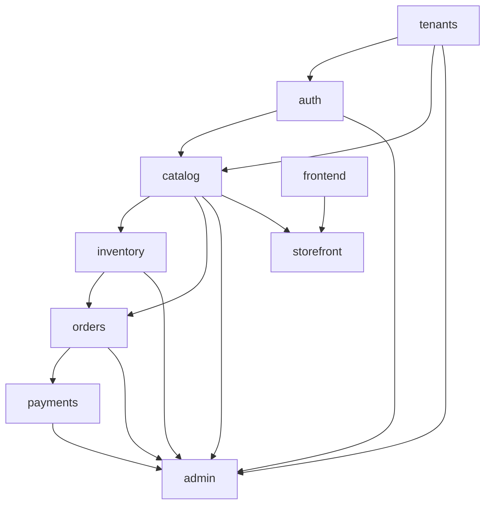

# Intent Backlog (proto-unidades) — Plataforma de tienda virtual multi-negocio

> Nivel de ideación. Proto-unidades de trabajo que la fase de Inception refinará en unidades formales con su DAG. Fecha: 2026-11-09.
>
> Entradas upstream: `intent-statement` (Intent Capture) y `constraint-register` / `feasibility-assessment` (Feasibility).

## Proto-unidades (9), con prioridad y dependencias

| # | Unidad | Descripción (nivel de problema) | MoSCoW | Depende de |
|---|---|---|---|---|
| 1 | **tenants** | Registro de comercios, creación automática de tienda, configuración básica (nombre, logo, colores, moneda, contacto), subdominio, plan y estado de pago manual. | Must | — |
| 2 | **auth** | Autenticación y autorización: staff por tienda, clientes compradores, super-admin de plataforma; aislamiento de datos entre tiendas. | Must | tenants |
| 3 | **catalog** | Productos, variantes, categorías, imágenes, landing pública, búsqueda simple. | Must | tenants, auth |
| 4 | **inventory** | SKU, stock, movimientos auditables, reserva de stock con liberación por vencimiento. | Must | catalog |
| 5 | **orders** | Carrito persistente (anónimo y autenticado), checkout, impuestos y descuentos configurables, órdenes y estados. | Must | catalog, inventory |
| 6 | **payments** | Pago manual por transferencia con comprobante (aprobación/rechazo del admin) y adaptador de pasarela (checkout alojado/tokenización, sin retención de fondos); webhooks idempotentes. El pago manual se entrega primero. | Must | orders |
| 7 | **admin** | Panel del comercio (productos, inventario, órdenes, aprobación de pagos manuales, config de pagos) y panel de super-admin (tiendas, plan/estado de pago, métricas básicas, soporte solo lectura auditado); notificaciones transaccionales. | Must (básico) | tenants, auth, catalog, inventory, orders, payments |
| 8 | **storefront** | Plantillas y personalización de la tienda pública: ≥1 plantilla base bien diseñada y personalizable por tienda. Requiere investigación previa de licencias (uso comercial en SaaS), mantenimiento, accesibilidad y rendimiento. | Must (una plantilla) | catalog, frontend |
| 9 | **frontend** | App web responsiva que consume las unidades anteriores (landing, tienda, carrito, checkout, paneles); construcción incremental, no al final. | Must | (incremental con cada unidad) |

## Orden de construcción propuesto (con walking skeleton)

**Fase 0 — Walking skeleton (riesgo primero):** una tienda mínima end-to-end que atraviese tenants + auth + catalog + inventory + orders + pago manual + frontend mínimo: crear una tienda, publicar un producto con stock, completar una orden con pago manual aprobado, con aislamiento entre tiendas verificado. Valida los riesgos R1-R3 (reserva de stock, consistencia de órdenes/pagos, aislamiento multi-tenant). [Q2] [Q5]

**Luego, completar cada unidad en orden:**
1. tenants + auth (base de identidad y aislamiento)
2. catalog
3. inventory
4. orders
5. payments (manual primero, luego pasarela)
6. admin (básico primero)
7. storefront (tras la investigación de plantillas)

frontend se construye de forma incremental junto a cada unidad.

## DAG de dependencias (Mermaid)

Texto alternativo del diagrama: `tenants` es la raíz; `auth` y `catalog` dependen de `tenants` (y `catalog` también de `auth`); `inventory` y `orders` dependen de `catalog` (`orders` también de `inventory`); `payments` depende de `orders`; `admin` depende de todas las anteriores; `storefront` depende de `catalog` y `frontend`; `frontend` se desarrolla incrementalmente junto a las demás.

## Mapa de valor (de capacidad a resultado)

- tenants + auth → un comercio tiene su tienda propia y aislada → base del SaaS.
- catalog + storefront + frontend → el comercio publica su catálogo con una landing no genérica → primer valor visible.
- inventory + orders + payments → el comercio vende sin sobreventa y con órdenes consistentes → valor transaccional (métrica de éxito).
- admin → el comercio opera su negocio y el super-admin administra la plataforma → operación autónoma de los pilotos.

## Assumptions & Open Questions

- [assumption] Este backlog es a nivel de proto-unidad; la fase de Inception (Domain Design y Units Generation) formalizará las unidades, sus límites y el DAG definitivo. [scope]
- [assumption] La unidad `storefront` depende de una investigación de licencias de plantillas (uso comercial en SaaS) a realizar antes de construir el frontend. [Q1]
- [assumption] El walking skeleton puede cruzar varias unidades parcialmente antes de completarlas; es una decisión de secuencia de construcción que Delivery Planning afinará. [Q2]
