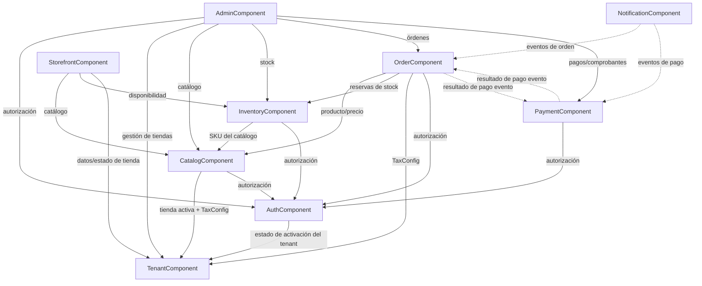

# Catálogo de componentes de dominio — Plataforma de tienda virtual multi-negocio

> Fase: Inception / Domain Design. Fecha: 2026-11-12. Componentes = bloques lógicos de software que escribimos (no infraestructura que desplegamos). Esta etapa NO decide topología de despliegue (Units Generation), stack ni patrones NFR.
> Entradas upstream: `requirements.md`, `stories.md`, `team-practices.md`.
> El bloque YAML es la fuente de verdad; las tablas y el diagrama se derivan de él.
>
> Profundidad de entidades: nivel **propiedad + forma** (dueño, identificador, nombres de atributos, referencias cruzadas). Tipos, validaciones, cardinalidades y esquema físico (claves DynamoDB, OQ2) → Functional Design / data-modelling.

## Parte A — Catálogo (fuente de verdad)

```yaml
components:
  - name: TenantComponent
    summary: Ciclo de vida de la tienda (tenant), su configuración general y tributaria, y la suscripción.
    behaviour: >
      Crea la tienda al registrarse un comercio (la identidad Owner/Admin la crea AuthComponent).
      Mantiene el estado de activación del tenant, separado de la existencia de la identidad: una tienda
      recién creada queda NO activada hasta que el super-admin la activa. Expone operaciones globales
      autorizadas del super-admin sobre el ciclo de vida de Store (crear/suspender/reactivar/activar) y el
      plan/estado de pago de la suscripción (manual). Posee la configuración tributaria por producto/categoría,
      con precedencia producto-sobre-categoría y sin acumulación. La autorización NO es una llamada saliente de
      TenantComponent: el rol/identidad del solicitante se resuelve y valida en el LÍMITE (vía TenantContext y la
      base de autorización de AuthComponent) ANTES de entrar a TenantComponent, por lo que TenantComponent no
      depende síncronamente de AuthComponent (ver ADR-008). Las operaciones globales del super-admin son la única
      excepción al filtro de tenant, autorizada y auditada.
    responsibilities:
      - Ciclo de vida y estado de activación de la tienda (Store)
      - Plan y estado de pago de la suscripción (registro manual, visible solo al super-admin)
      - Configuración tributaria de la tienda (TaxConfig) con precedencia producto-sobre-categoría
      - Operaciones globales autorizadas del super-admin sobre tiendas (auditadas)
    depends_on: []
    dependents:
      - component: AuthComponent
        interaction: lee el estado de activación del tenant (dato) al autenticar/operar
      - component: CatalogComponent
        interaction: valida tienda activa y lee datos de tienda por contrato
      - component: OrderComponent
        interaction: lee TaxConfig para el cálculo y snapshot de la orden
      - component: StorefrontComponent
        interaction: lee datos públicos de la tienda y su estado (publicada/suspendida)
      - component: AdminComponent
        interaction: coordina vistas y operaciones de gestión de tiendas
    external_dependencies:
      - name: DynamoDB
        kind: database
        purpose: persistencia de Store, TaxConfig y datos de suscripción (modelo físico definido en data-modelling)
    entities:
      - name: Store
        identifier: storeId
        attributes: [storeId, name, subdomain, logoRef, brandColors, currency, contact, activationState, createdAt]
      - name: Subscription
        identifier: storeId
        attributes: [storeId, plan, paymentStatus, updatedAt]
        references:
          - entity: Store
            owned_by: TenantComponent
            relationship: "cada Subscription pertenece a una Store"
      - name: TaxConfig
        identifier: taxConfigId
        attributes: [taxConfigId, scope, scopeRef, ratePercent, isExempt]
        references:
          - entity: Product
            owned_by: CatalogComponent
            relationship: "una TaxConfig de producto aplica a un Product; la de categoría aplica a una Category"

  - name: AuthComponent
    summary: Identidad de usuarios, roles por tienda y autorización; ancla del aislamiento multi-tenant.
    behaviour: >
      Posee UserIdentity y la asignación de roles por tienda para los cinco perfiles: super_admin, owner_admin,
      catalog_inventory_staff, orders_staff y customer. La identidad Owner/Admin se crea al registrarse el comercio,
      independiente del estado de activación del tenant (que es de TenantComponent). Valida permisos en backend bajo
      mínimo privilegio. El comprador invitado es una modalidad de checkout sin cuenta ni credenciales, no una
      identidad. Provee la base de autorización que TenantContext usa para el aislamiento; ningún usuario de una
      tienda accede a datos de otra salvo operación global autorizada del super-admin.
    responsibilities:
      - Identidad de usuario y credenciales (UserIdentity)
      - Asignación de roles/permisos por tienda (RoleAssignment)
      - Autorización bajo mínimo privilegio en los límites
      - Registro de auditoría del acceso de soporte solo-lectura del super-admin
    depends_on:
      - component: TenantComponent
        interaction: leer el estado de activación/datos del tenant (dato) al autenticar; única dirección síncrona del par (ADR-008)
        style: sync
    dependents:
      - component: CatalogComponent
        interaction: autoriza operaciones de catálogo por rol
      - component: InventoryComponent
        interaction: autoriza operaciones de inventario por rol
      - component: OrderComponent
        interaction: autoriza y asocia el comprador autenticado a sus órdenes
      - component: PaymentComponent
        interaction: autoriza aprobación/rechazo de comprobantes (owner_admin / orders_staff) y acceso a config de pagos (owner_admin)
      - component: AdminComponent
        interaction: autoriza el acceso a vistas y acciones administrativas por rol
    external_dependencies:
      - name: Identity Provider (Cognito u otro)
        kind: third-party-api
        purpose: autenticación de identidades (proveedor concreto a fijar en diseño técnico)
      - name: DynamoDB
        kind: database
        purpose: persistencia de UserIdentity y RoleAssignment
    entities:
      - name: UserIdentity
        identifier: userId
        attributes: [userId, email, role, storeId, status, createdAt]
        references:
          - entity: Store
            owned_by: TenantComponent
            relationship: "cada UserIdentity de tienda pertenece a una Store (salvo super_admin, global)"
      - name: RoleAssignment
        identifier: roleAssignmentId
        attributes: [roleAssignmentId, userId, storeId, role]
        references:
          - entity: UserIdentity
            owned_by: AuthComponent
            relationship: "cada RoleAssignment asigna un rol a una UserIdentity en una Store"

  - name: CatalogComponent
    summary: Catálogo de productos, variantes y categorías de cada tienda.
    behaviour: >
      Posee Product, Category y Variant, con las imágenes como referencia a un object-store (no binarios en el
      modelo). Expone operaciones administrativas (alta/edición por catalog_inventory_staff y owner_admin) y de
      consulta. El impuesto efectivo de un producto respeta la precedencia producto-sobre-categoría definida en
      TaxConfig (propiedad de TenantComponent). La disponibilidad de stock no vive aquí: se consulta a
      InventoryComponent por contrato.
    responsibilities:
      - Productos, categorías y variantes (con SKU por variante)
      - Referencias a imágenes en object-store
      - Consulta administrativa y pública del catálogo (vía contrato)
    depends_on:
      - component: TenantComponent
        interaction: validar tienda activa y leer TaxConfig aplicable
        style: sync
      - component: AuthComponent
        interaction: autorizar operaciones de catálogo por rol
        style: sync
    dependents:
      - component: InventoryComponent
        interaction: el stock se lleva por SKU que define el catálogo
      - component: OrderComponent
        interaction: el checkout lee producto/precio/variante del catálogo
      - component: StorefrontComponent
        interaction: la tienda pública consume el catálogo por contrato
      - component: AdminComponent
        interaction: vistas y acciones de catálogo en el panel
    external_dependencies:
      - name: Object Store (S3 u otro)
        kind: object-store
        purpose: almacenamiento de imágenes de producto (referencia por URL/clave)
      - name: DynamoDB
        kind: database
        purpose: persistencia de Product, Category, Variant
    entities:
      - name: Product
        identifier: productId
        attributes: [productId, storeId, name, description, categoryId, basePrice, imageRefs, taxConfigRef]
        references:
          - entity: Category
            owned_by: CatalogComponent
            relationship: "cada Product pertenece a una Category"
      - name: Category
        identifier: categoryId
        attributes: [categoryId, storeId, name]
      - name: Variant
        identifier: sku
        attributes: [sku, productId, attributes, price]
        references:
          - entity: Product
            owned_by: CatalogComponent
            relationship: "cada Variant pertenece a un Product y tiene su propio SKU"

  - name: InventoryComponent
    summary: Stock por SKU, movimientos auditables y reservas; garante de la no-sobreventa (R1).
    behaviour: >
      Posee StockItem (stock por SKU), StockMovement (entradas/salidas/ajustes auditables) y Reservation (con
      expiresAt). Garantiza la no-sobreventa bajo concurrencia: ante N reservas concurrentes sobre stock M (N>M),
      exactamente M tienen éxito, sin stock negativo. La liberación por vencimiento es EXPLÍCITA (por expiresAt en
      la ruta de lectura y en un barrido/reclamo), NO delega el vencimiento al TTL de DynamoDB. Reservar, confirmar
      y liberar son operaciones atómicas e idempotentes: no hay doble liberación, ni doble consumo, ni confirmación
      de reservas vencidas. OrderComponent solicita estas operaciones por contrato, sin tocar el almacenamiento.
    responsibilities:
      - Stock por SKU (StockItem) y movimientos auditables (StockMovement)
      - Reservas con expiresAt (Reservation): crear, confirmar (salida definitiva), liberar
      - Invariante de no-sobreventa bajo concurrencia (R1)
      - Liberación explícita por vencimiento, atómica e idempotente (sin TTL)
    depends_on:
      - component: CatalogComponent
        interaction: el stock se indexa por el SKU que define el catálogo
        style: sync
      - component: AuthComponent
        interaction: autorizar operaciones de inventario por rol
        style: sync
    dependents:
      - component: OrderComponent
        interaction: solicita crear/confirmar/liberar reservas en el checkout y al resolver el pago
      - component: StorefrontComponent
        interaction: consulta disponibilidad para mostrarla en la tienda pública
      - component: AdminComponent
        interaction: muestra stock y movimientos en el panel
    external_dependencies:
      - name: DynamoDB
        kind: database
        purpose: persistencia de StockItem, StockMovement, Reservation con escritura condicional/transaccional (modelo en data-modelling)
    entities:
      - name: StockItem
        identifier: sku
        attributes: [sku, storeId, available, reserved]
        references:
          - entity: Variant
            owned_by: CatalogComponent
            relationship: "cada StockItem corresponde a un SKU/Variant del catálogo"
      - name: StockMovement
        identifier: movementId
        attributes: [movementId, sku, type, quantity, occurredAt]
      - name: Reservation
        identifier: reservationId
        attributes: [reservationId, sku, orderId, quantity, state, expiresAt, createdAt]
        references:
          - entity: Order
            owned_by: OrderComponent
            relationship: "cada Reservation referencia la Order que la originó"

  - name: OrderComponent
    summary: Carrito, checkout y la orden con su máquina de estados y snapshot inmutable.
    behaviour: >
      Posee Cart, Order y OrderLineItem. La Order tiene su propia máquina de estados (pending_payment, paid,
      expired, cancelled): las ÚNICAS transiciones dirigidas por pago/tiempo son `paid` (aprobación válida) y
      `expired` (vencimiento de la reserva); un pago rejected/failed NO cancela ni marca `paid` la orden. Los
      estados terminales no retroceden. Al crear la orden toma un snapshot inmutable (moneda, ítems, cantidades,
      precios, descuento, base gravable, impuestos, total) usando la TaxConfig vigente; cambios posteriores en
      catálogo o impuestos no alteran órdenes históricas. Solicita reservas a InventoryComponent y reacciona a
      eventos de PaymentComponent de forma idempotente. El checkout muestra el descuento solo si existe (opcional).
    responsibilities:
      - Carrito persistente (anónimo y autenticado)
      - Creación de la orden y cálculo de totales (impuestos vía TaxConfig; descuento opcional)
      - Máquina de estados de la orden y su auditoría
      - Snapshot inmutable de la orden
      - Coordinación con inventario (reservas) y con pagos (vía eventos idempotentes)
    depends_on:
      - component: CatalogComponent
        interaction: leer producto/variante/precio en el checkout
        style: sync
      - component: InventoryComponent
        interaction: crear/confirmar/liberar reservas de stock
        style: sync
      - component: TenantComponent
        interaction: leer TaxConfig para el cálculo y el snapshot
        style: sync
      - component: AuthComponent
        interaction: autorizar y asociar el comprador autenticado a sus órdenes
        style: sync
      - component: PaymentComponent
        interaction: reaccionar al resultado de pago (evento) para transicionar la orden
        style: event
    dependents:
      - component: PaymentComponent
        interaction: el pago referencia la orden (orderId) y publica su resultado
      - component: InventoryComponent
        interaction: la reserva referencia la orden
      - component: NotificationComponent
        interaction: publica eventos de orden creada/pagada/vencida
      - component: AdminComponent
        interaction: lista y muestra órdenes y su estado
    external_dependencies:
      - name: DynamoDB
        kind: database
        purpose: persistencia de Cart, Order, OrderLineItem y el snapshot
      - name: EventBridge
        kind: queue
        purpose: publicar/consumir eventos de orden y pago (bus a fijar en diseño)
    entities:
      - name: Cart
        identifier: cartId
        attributes: [cartId, storeId, buyerRef, items, updatedAt]
      - name: Order
        identifier: orderId
        attributes: [orderId, storeId, buyerRef, state, snapshot, createdAt]
        references:
          - entity: Store
            owned_by: TenantComponent
            relationship: "cada Order pertenece a una Store"
      - name: OrderLineItem
        identifier: orderLineItemId
        attributes: [orderLineItemId, orderId, sku, quantity, unitPrice, taxAmount, discountAmount]
        references:
          - entity: Order
            owned_by: OrderComponent
            relationship: "cada OrderLineItem pertenece a una Order"
          - entity: Variant
            owned_by: CatalogComponent
            relationship: "cada OrderLineItem referencia un SKU/Variant (valores congelados en el snapshot)"

  - name: PaymentComponent
    summary: Pago consolidado, historial de intentos, comprobante manual y configuración de métodos de pago.
    behaviour: >
      Posee Payment (estado consolidado: pending, pending_review, approved, rejected, failed), PaymentAttempt
      (historial individual de intentos, cada uno con su resultado y timestamp), TransferProof (comprobante de
      transferencia, cifrado, acceso solo a owner_admin/orders_staff de la tienda y super-admin en soporte
      auditado) y PaymentMethodConfig (datos de transferencia y conexión de pasarela; credenciales SOLO por
      referencia a secreto, nunca en claro). Distingue rejected (rechazo manual del comprobante) de failed
      (fallo del intento en pasarela). Un intento fallido/rechazado no sobrescribe el resultado de un intento
      posterior; el estado consolidado se deriva del historial (approved solo si hay un intento aprobado).
      Verifica la firma de los webhooks de pasarela con el mecanismo oficial del proveedor y los procesa
      idempotentemente: entregas duplicadas/tardías/fuera de orden producen un único efecto y no retroceden
      estados terminales. Publica el resultado del pago como evento hacia OrderComponent.
    responsibilities:
      - Estado consolidado del pago (Payment) por orden
      - Historial de intentos (PaymentAttempt) sin sobrescritura
      - Comprobante manual (TransferProof) cifrado y con acceso restringido
      - Configuración de métodos de pago de la tienda (PaymentMethodConfig; credenciales por referencia a secreto)
      - Verificación de firma e idempotencia de webhooks de pasarela
      - Aprobación/rechazo manual por owner_admin u orders_staff
    depends_on:
      - component: AuthComponent
        interaction: autorizar aprobación/rechazo (owner_admin/orders_staff) y acceso a config de pagos (owner_admin)
        style: sync
      - component: OrderComponent
        interaction: publicar el resultado de pago para transicionar la orden
        style: event
    dependents:
      - component: OrderComponent
        interaction: consume el evento de resultado de pago (idempotente)
      - component: NotificationComponent
        interaction: publica eventos de comprobante pendiente / pago aprobado / rechazado / fallido
      - component: AdminComponent
        interaction: muestra pagos y la cola de revisión de comprobantes
    external_dependencies:
      - name: Payment Gateway (adaptador genérico)
        kind: third-party-api
        purpose: checkout alojado/tokenización y webhooks; credenciales propias del comercio; la plataforma no retiene fondos
      - name: Secrets Manager / SSM
        kind: other
        purpose: almacenamiento de credenciales de pasarela (referenciadas, nunca en claro en el modelo)
      - name: Object Store (S3 u otro)
        kind: object-store
        purpose: almacenamiento cifrado del comprobante de transferencia (acceso restringido, sin acceso público permanente)
      - name: DynamoDB
        kind: database
        purpose: persistencia de Payment, PaymentAttempt, PaymentMethodConfig y metadatos del comprobante
    entities:
      - name: Payment
        identifier: paymentId
        attributes: [paymentId, orderId, storeId, method, consolidatedState, updatedAt]
        references:
          - entity: Order
            owned_by: OrderComponent
            relationship: "cada Payment corresponde a una Order (por orderId)"
      - name: PaymentAttempt
        identifier: attemptId
        attributes: [attemptId, paymentId, kind, result, reason, occurredAt]
        references:
          - entity: Payment
            owned_by: PaymentComponent
            relationship: "cada PaymentAttempt pertenece a un Payment; el historial no se sobrescribe"
      - name: TransferProof
        identifier: proofId
        attributes: [proofId, paymentId, objectRef, uploadedAt, reviewState, reviewedBy, reviewedAt, rejectionReason]
        references:
          - entity: Payment
            owned_by: PaymentComponent
            relationship: "cada TransferProof pertenece a un Payment manual"
      - name: PaymentMethodConfig
        identifier: storeId
        attributes: [storeId, transferDetails, gatewayConnectionState, gatewayCredentialSecretRef, enabledMethods]
        references:
          - entity: Store
            owned_by: TenantComponent
            relationship: "cada PaymentMethodConfig pertenece a una Store"

  - name: StorefrontComponent
    summary: Presentación pública de la tienda por subdominio y personalización visual.
    behaviour: >
      Resuelve la tienda por su subdominio (vía TenantContext a partir del subdominio) y renderiza el catálogo,
      el detalle, el carrito y el checkout usando una plantilla base funcional (default) más personalización por
      tienda (color primario, acento, logo, tipografía). Posee SOLO la configuración de presentación (StoreTheme);
      consume el catálogo (CatalogComponent) y la disponibilidad (InventoryComponent) por contrato, sin poseer sus
      entidades. Expone un punto de reentrada genérico para consultar la orden (OQ-US-1 abierta; no fija el mecanismo).
      La selección de plantillas adicionales (US3.5) es Could y queda fuera del skeleton.
    responsibilities:
      - Resolución de la tienda por subdominio y render público
      - Personalización visual por tienda (StoreTheme / tokens de marca)
      - Consumo por contrato de catálogo e inventario (sin propiedad de entidades)
    depends_on:
      - component: CatalogComponent
        interaction: leer el catálogo público
        style: sync
      - component: InventoryComponent
        interaction: consultar disponibilidad
        style: sync
      - component: TenantComponent
        interaction: resolver datos y estado público de la tienda (publicada/suspendida)
        style: sync
    dependents: []
    external_dependencies:
      - name: CDN (CloudFront u otro)
        kind: other
        purpose: entrega del frontend público (a fijar en infraestructura)
      - name: DynamoDB
        kind: database
        purpose: persistencia de StoreTheme
    entities:
      - name: StoreTheme
        identifier: storeId
        attributes: [storeId, templateId, primaryColor, accentColor, logoRef, fontFamily]
        references:
          - entity: Store
            owned_by: TenantComponent
            relationship: "cada StoreTheme pertenece a una Store"

  - name: AdminComponent
    summary: Coordinación de operaciones y vistas administrativas; no posee entidades de negocio.
    behaviour: >
      Orquesta las vistas y acciones de los paneles (comercio y super-admin) consumiendo los contratos de los
      componentes propietarios: productos/inventario (Catalog/Inventory), órdenes y revisión de pagos
      (Order/Payment), configuración (Tenant/Payment), gestión de tiendas y métricas (Tenant). NO duplica ni posee
      entidades: la propiedad permanece en los componentes de dominio. Aplica la autorización por rol de
      AuthComponent (visibilidad del panel por rol) y deja auditado el soporte solo-lectura del super-admin.
    responsibilities:
      - Composición de vistas administrativas por rol (comercio y plataforma)
      - Enrutamiento de acciones administrativas a los componentes propietarios
      - Vistas de métricas agregadas por consulta/contrato autorizado
    depends_on:
      - component: AuthComponent
        interaction: autorizar acceso y acciones por rol
        style: sync
      - component: TenantComponent
        interaction: gestión de tiendas, plan/estado de pago, activación (operaciones del super-admin)
        style: sync
      - component: CatalogComponent
        interaction: vistas y acciones de catálogo
        style: sync
      - component: InventoryComponent
        interaction: vistas de stock y movimientos
        style: sync
      - component: OrderComponent
        interaction: listado y detalle de órdenes
        style: sync
      - component: PaymentComponent
        interaction: cola de revisión de comprobantes y estado de pagos
        style: sync
    dependents: []
    external_dependencies: []
    entities: []

  - name: NotificationComponent
    summary: Notificaciones transaccionales reactivas a eventos; componente lógico ligero.
    behaviour: >
      Reacciona a eventos de orden y pago (consume eventos; no se le llama síncronamente) para enviar
      notificaciones transaccionales por el canal de menor costo, sin incluir datos sensibles. Posee solo el
      registro mínimo de notificación (NotificationLog) para trazabilidad e idempotencia (una entrega por evento).
      El aviso al staff cuando un comprobante queda pending_review es parte del flujo manual (Must); las demás
      notificaciones conservan su prioridad del alcance. No posee órdenes, pagos ni datos de clientes. Su ubicación
      física entre las 9 unidades se decide en Units Generation (no crea una 10ª unidad).
    responsibilities:
      - Consumo idempotente de eventos de orden/pago
      - Envío de notificaciones transaccionales (canal de menor costo, sin datos sensibles)
      - Registro mínimo de notificación (NotificationLog) para trazabilidad e idempotencia
    depends_on:
      - component: OrderComponent
        interaction: consumir eventos de orden (creada/pagada/vencida)
        style: event
      - component: PaymentComponent
        interaction: consumir eventos de pago (comprobante pendiente/aprobado/rechazado/fallido)
        style: event
    dependents: []
    external_dependencies:
      - name: Notification channel (email/SES u otro)
        kind: third-party-api
        purpose: envío de la notificación por el canal de menor costo (a fijar en diseño)
      - name: EventBridge
        kind: queue
        purpose: fuente de eventos de orden/pago que dispara las notificaciones
      - name: DynamoDB
        kind: database
        purpose: persistencia de NotificationLog
    entities:
      - name: NotificationLog
        identifier: notificationId
        attributes: [notificationId, eventRef, channel, status, sentAt]
```

> **TenantContext** es una **preocupación transversal** (resolución y validación de `tenant_id` en el límite de cada componente), no un componente de dominio con entidades propias ni una unidad. El `frontend` es consumidor de los contratos del backend y no posee entidades de dominio. Por eso ninguno aparece en el catálogo de componentes.

## Parte B — Vista para humanos

### Diagrama de componentes



> Aristas continuas = interacción síncrona (REST por contrato); aristas punteadas = interacción por evento (asíncrona).

### Resumen de componentes

| Component | Purpose | Depends On | Dependents | Entities Owned |
|---|---|---|---|---|
| TenantComponent | Ciclo de vida de la tienda, config tributaria, suscripción | (ninguno) | Auth, Catalog, Order, Storefront, Admin | Store, Subscription, TaxConfig |
| AuthComponent | Identidad, roles y autorización; base del aislamiento | TenantComponent | Catalog, Inventory, Order, Payment, Admin | UserIdentity, RoleAssignment |
| CatalogComponent | Productos, categorías, variantes | Tenant, Auth | Inventory, Order, Storefront, Admin | Product, Category, Variant |
| InventoryComponent | Stock, movimientos y reservas; no-sobreventa (R1) | Catalog, Auth | Order, Storefront, Admin | StockItem, StockMovement, Reservation |
| OrderComponent | Carrito, checkout, orden + estados + snapshot | Catalog, Inventory, Tenant, Auth, Payment | Payment, Inventory, Notification, Admin | Cart, Order, OrderLineItem |
| PaymentComponent | Pago consolidado, intentos, comprobante, config de métodos | Auth, Order | Order, Notification, Admin | Payment, PaymentAttempt, TransferProof, PaymentMethodConfig |
| StorefrontComponent | Presentación pública por subdominio + personalización | Catalog, Inventory, Tenant | — | StoreTheme |
| AdminComponent | Coordinación de vistas/acciones administrativas | Auth, Tenant, Catalog, Inventory, Order, Payment | — | (ninguna) |
| NotificationComponent | Notificaciones transaccionales reactivas a eventos | Order, Payment | — | NotificationLog |

### Propiedad de entidades

| Entity | Owning Component | Identifier | Attributes | References |
|---|---|---|---|---|
| Store | TenantComponent | storeId | storeId, name, subdomain, logoRef, brandColors, currency, contact, activationState, createdAt | — |
| Subscription | TenantComponent | storeId | storeId, plan, paymentStatus, updatedAt | Store |
| TaxConfig | TenantComponent | taxConfigId | taxConfigId, scope, scopeRef, ratePercent, isExempt | Product/Category |
| UserIdentity | AuthComponent | userId | userId, email, role, storeId, status, createdAt | Store |
| RoleAssignment | AuthComponent | roleAssignmentId | roleAssignmentId, userId, storeId, role | UserIdentity |
| Product | CatalogComponent | productId | productId, storeId, name, description, categoryId, basePrice, imageRefs, taxConfigRef | Category |
| Category | CatalogComponent | categoryId | categoryId, storeId, name | — |
| Variant | CatalogComponent | sku | sku, productId, attributes, price | Product |
| StockItem | InventoryComponent | sku | sku, storeId, available, reserved | Variant |
| StockMovement | InventoryComponent | movementId | movementId, sku, type, quantity, occurredAt | — |
| Reservation | InventoryComponent | reservationId | reservationId, sku, orderId, quantity, state, expiresAt, createdAt | Order |
| Cart | OrderComponent | cartId | cartId, storeId, buyerRef, items, updatedAt | — |
| Order | OrderComponent | orderId | orderId, storeId, buyerRef, state, snapshot, createdAt | Store |
| OrderLineItem | OrderComponent | orderLineItemId | orderLineItemId, orderId, sku, quantity, unitPrice, taxAmount, discountAmount | Order, Variant |
| Payment | PaymentComponent | paymentId | paymentId, orderId, storeId, method, consolidatedState, updatedAt | Order |
| PaymentAttempt | PaymentComponent | attemptId | attemptId, paymentId, kind, result, reason, occurredAt | Payment |
| TransferProof | PaymentComponent | proofId | proofId, paymentId, objectRef, uploadedAt, reviewState, reviewedBy, reviewedAt, rejectionReason | Payment |
| PaymentMethodConfig | PaymentComponent | storeId | storeId, transferDetails, gatewayConnectionState, gatewayCredentialSecretRef, enabledMethods | Store |
| StoreTheme | StorefrontComponent | storeId | storeId, templateId, primaryColor, accentColor, logoRef, fontFamily | Store |
| NotificationLog | NotificationComponent | notificationId | notificationId, eventRef, channel, status, sentAt | — |

### Dependencias externas

| Component | Dependency | Kind | Purpose |
|---|---|---|---|
| TenantComponent | DynamoDB | database | Persistencia de Store, TaxConfig, suscripción |
| AuthComponent | Identity Provider (Cognito u otro) | third-party-api | Autenticación de identidades (proveedor en diseño técnico) |
| AuthComponent | DynamoDB | database | Persistencia de UserIdentity, RoleAssignment |
| CatalogComponent | Object Store (S3 u otro) | object-store | Imágenes de producto (por referencia) |
| CatalogComponent | DynamoDB | database | Persistencia de Product, Category, Variant |
| InventoryComponent | DynamoDB | database | StockItem/Movement/Reservation con escritura condicional |
| OrderComponent | DynamoDB | database | Cart, Order, OrderLineItem, snapshot |
| OrderComponent | EventBridge | queue | Eventos de orden/pago |
| PaymentComponent | Payment Gateway (adaptador) | third-party-api | Checkout alojado/tokenización y webhooks |
| PaymentComponent | Secrets Manager / SSM | other | Credenciales de pasarela (por referencia) |
| PaymentComponent | Object Store (S3 u otro) | object-store | Comprobante cifrado, acceso restringido |
| PaymentComponent | DynamoDB | database | Payment, PaymentAttempt, PaymentMethodConfig, metadatos de comprobante |
| StorefrontComponent | CDN (CloudFront u otro) | other | Entrega del frontend público |
| StorefrontComponent | DynamoDB | database | StoreTheme |
| NotificationComponent | Notification channel (SES u otro) | third-party-api | Envío de notificación (canal de menor costo) |
| NotificationComponent | EventBridge | queue | Fuente de eventos de orden/pago |
| NotificationComponent | DynamoDB | database | NotificationLog |

> Las elecciones de servicio AWS concretas son **ilustrativas** (coherentes con la restricción C1); el mapeo definitivo a servicios y el modelo físico de datos se fijan en infraestructura y data-modelling, no aquí.

### Invariantes de dominio (reglas que el modelo garantiza)

| # | Invariante | Componente(s) garante(s) | Ancla |
|---|---|---|---|
| I1 | **Aislamiento multi-tenant:** ninguna operación cruza `tenant_id`; la única excepción es la operación global autorizada y auditada del super-admin | TenantContext (transversal) + Auth + Tenant | R3, NFR1.1, FR2.5/2.6 |
| I2 | **No sobreventa:** reservas activas + salidas ≤ stock disponible, bajo concurrencia, sin stock negativo | InventoryComponent | R1, NFR2.1, FR4.2/4.3 |
| I3 | **Liberación por vencimiento explícita:** la reserva vence por `expiresAt`; liberación atómica e idempotente, sin depender del TTL; una reserva vencida no se confirma | InventoryComponent | R1, FR4.4/4.5 |
| I4 | **Consistencia orden↔pago:** máquinas separadas; `rejected`/`failed` no cancela ni marca `paid` la orden; estados terminales no retroceden; eventos duplicados idempotentes | OrderComponent + PaymentComponent | R2, NFR2.2, FR5.3/5.4/5.5 |
| I5 | **Historial de intentos de pago:** cada `PaymentAttempt` conserva su resultado; un intento fallido/rechazado no sobrescribe uno posterior; el estado consolidado se deriva del historial | PaymentComponent | R2, FR5.4 |
| I6 | **Snapshot inmutable de la orden:** moneda, ítems, cantidades, precios, descuento, base gravable, impuestos y total se congelan al crear la orden; cambios posteriores no alteran órdenes históricas | OrderComponent | FR7.3, FR5.3 |
| I7 | **Propiedad única de entidad:** cada entidad tiene un único componente dueño; los demás acceden solo por contrato, nunca al almacenamiento ajeno | Todos | team-practices (regla de frontera) |

### Rationale — por qué cada componente es un bloque separado

| Componente | Razón de separación |
|---|---|
| TenantComponent | Distinto ciclo de vida (activación, suscripción) y propiedad de datos de tienda; raíz del aislamiento |
| AuthComponent | Concern de identidad/autorización, cambia por razones de seguridad independientes del negocio |
| CatalogComponent | Datos de producto con su propio ritmo de cambio (alta frecuencia de edición de catálogo) |
| InventoryComponent | Dueño del invariante crítico de concurrencia (no-sobreventa) y de la reserva; aislarlo acota el riesgo R1 |
| OrderComponent | Máquina de estados y snapshot propios; corazón del flujo de compra |
| PaymentComponent | Concern de pago con seguridad y PCI reducido; aislarlo acota el riesgo R2 y el manejo de secretos/comprobantes |
| StorefrontComponent | Presentación pública con ritmo de cambio visual distinto; no debe poseer datos de negocio |
| AdminComponent | Coordinación/orquestación sin propiedad de datos; evita duplicar entidades entre paneles |
| NotificationComponent | Efecto desacoplado y reactivo; aislarlo evita acoplar order/payment a canales de salida |

**Decomposición elegida y alternativas rechazadas:** se eligió un componente de dominio por unidad de negocio (opción A de Q1), con pagos unificado (no dividido en manual/pasarela) porque comparten el mismo estado consolidado y el historial de intentos; y orden y pago separados (no fusionados) porque tienen ciclos de vida e invariantes distintos. Las alternativas rechazadas se documentan en `decisions.md` (ADR-002, ADR-003).

## Sources

- [requirements] FR1–FR9, NFR1–NFR9; OQ2 (modelo de datos a data-modelling).
- [stories] US refinadas (estados orden/pago separados, identidad vs activación, config restringida, invitado OQ-US-1, reservas atómicas).
- [team-practices] reglas de frontera (sin acoplamiento a BD; `tenant_id` transversal; dependencias alineadas al orden; contratos OpenAPI).
- Q1–Q10 de `domain-design-questions.md`.

## Assumptions & Open Questions

- [assumption] Entidades a nivel propiedad+forma; tipos, validaciones, cardinalidades y modelo físico (claves DynamoDB, OQ2) → Functional Design / data-modelling.
- [assumption] La ubicación física de `NotificationComponent` entre las 9 unidades y la topología de despliegue → Units Generation.
- [assumption] Servicios AWS nombrados son ilustrativos (C1); el mapeo definitivo → infraestructura.
- OQ-US-1 — Mecanismo de consulta segura de la orden del comprador invitado: abierto; no se cierra en el modelo de dominio.
