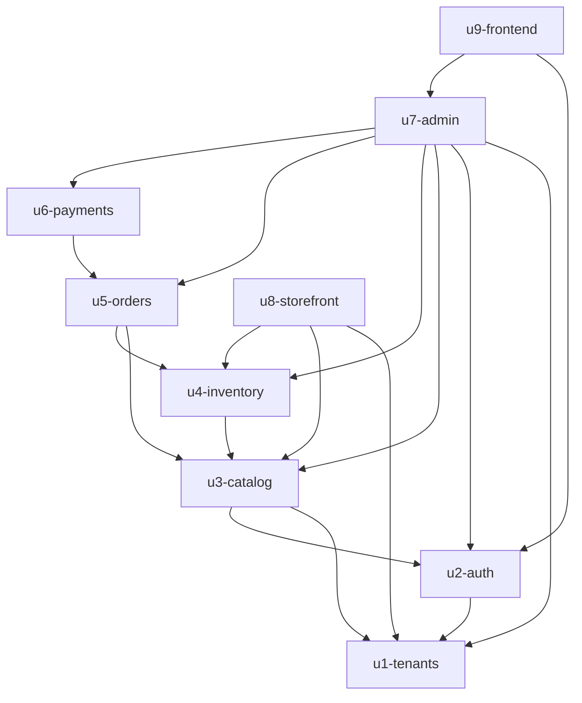

# DAG de dependencias entre unidades — Plataforma de tienda virtual multi-negocio

> Fase: Inception / Units Generation. Fecha: 2026-11-12. Topología de dependencias **de construcción** (directed, acíclico). Esta etapa NO elige un orden de construcción recomendado ni un camino crítico; eso es Delivery Planning (2.9).
>
> Distinción clave (Q7): el DAG modela **dependencias síncronas de construcción/ejecución** (una unidad necesita el código/contrato de otra para construir y pasar sus pruebas). Las **relaciones asíncronas por evento** (resultado de pago → orden; eventos de orden/pago → notificaciones) se documentan aparte y **no son aristas del DAG** ni crean ciclos.

## Edge block (fuente de verdad, acíclico)

```yaml
units:
  - name: u1-tenants
    kind: service
    depends_on: []
  - name: u2-auth
    kind: service
    depends_on: [u1-tenants]
  - name: u3-catalog
    kind: service
    depends_on: [u1-tenants, u2-auth]
  - name: u4-inventory
    kind: service
    depends_on: [u3-catalog]
  - name: u5-orders
    kind: service
    depends_on: [u3-catalog, u4-inventory]
  - name: u6-payments
    kind: service
    depends_on: [u5-orders]
  - name: u7-admin
    kind: service
    depends_on: [u1-tenants, u2-auth, u3-catalog, u4-inventory, u5-orders, u6-payments]
  - name: u8-storefront
    kind: ui
    depends_on: [u1-tenants, u3-catalog, u4-inventory]
  - name: u9-frontend
    kind: ui
    depends_on: [u2-auth, u7-admin]
```

## Diagrama del DAG (dependencias de construcción)



> Lectura: `A --> B` significa "A depende de B" (A necesita el código/contrato de B para construir y pasar sus pruebas). El grafo es acíclico.

## Dependencias de construcción (prosa)

| Unidad | Depende de | Por qué |
|---|---|---|
| u1-tenants | (ninguna) | unidad base; raíz del DAG |
| u2-auth | u1-tenants | lee el estado de activación del tenant por contrato (ADR-008) |
| u3-catalog | u1-tenants, u2-auth | opera dentro del contexto de tienda y autoriza por rol |
| u4-inventory | u3-catalog | el stock se indexa por el SKU que define el catálogo |
| u5-orders | u3-catalog, u4-inventory | el checkout lee producto/precio y solicita reservas |
| u6-payments | u5-orders | el pago se asocia a la orden por `orderId` y valida condiciones |
| u7-admin | u1,u2,u3,u4,u5,u6 | coordina vistas/acciones sobre los contratos de las unidades propietarias |
| u8-storefront | u1-tenants, u3-catalog, u4-inventory | resuelve tienda por subdominio, muestra catálogo y disponibilidad |
| u9-frontend | u2-auth, u7-admin | interfaces administrativas sobre los contratos publicados |

## Relaciones asíncronas por evento (NO son aristas del DAG)

Estas interacciones son de runtime, de consistencia eventual e idempotentes; no crean dependencias de construcción ni ciclos:

| Productor | Evento | Consumidor | Efecto |
|---|---|---|---|
| u6-payments | resultado de pago (approved/failed) | u5-orders | transiciona la orden idempotentemente (no reabre terminales) |
| u5-orders | orden creada / pagada / vencida | u6-payments (módulo notificación) | dispara notificación transaccional |
| u6-payments | comprobante `pending_review`, pago aprobado/rechazado/fallido | u6-payments (módulo notificación) | dispara notificación al staff/comprador |

> Nota: `u5-orders` y `u6-payments` tienen una única arista de construcción (`u6 → u5`): payments se construye sobre el contrato de orders. La reacción de orders al evento de pago es asíncrona y no invierte esa arista, por lo que no hay ciclo.

## Integración entre unidades

- **Contratos síncronos:** OpenAPI versionado por frontera (consultas/comandos con respuesta inmediata: catálogo/disponibilidad en checkout, reserva de stock, operaciones admin).
- **Contratos de eventos:** esquema de evento versionado con `id` único e idempotencia (resultado de pago, notificaciones).
- **`tenant_id`:** resuelto en el límite (TenantContext, U2), nunca tomado de un cuerpo no verificado.

## Oportunidades de paralelismo (informa a Delivery Planning; no altera unit-major)

Unidades sin dependencia entre sí, una vez disponibles sus bases, admiten órdenes topológicas alternativas:
- **u7-admin** y **u8-storefront** no dependen entre sí (ambas consumen contratos de unidades base ya construidas).
- **u8-storefront** no depende de **u5-orders** ni **u6-payments** (solo de u1/u3/u4), por lo que puede avanzar en paralelo a la línea orders→payments una vez listas catalog e inventory.
- **u2-auth** y la rama de catálogo comparten solo la base u1; tras u1, auth y catalog pueden progresar de forma independiente hasta donde catalog requiere auth.

> Esto es una propiedad de la topología y una entrada para Delivery Planning; el ritmo operativo sigue siendo **una unidad a la vez (unit-major)**.

## Walking skeleton (slice integrado, no unidad del DAG)

El walking skeleton es un corte vertical que atraviesa u1, u2, u3, u4, u5, u6 y u8 con lo mínimo de cada una, para ejercitar R1/R2/R3 end-to-end antes de profundizar cada unidad. No es una unidad del edge-block ni una dependencia artificial; es un hito de integración y validación temprana cuya compuerta de salida son las pruebas R1/R2/R3 en verde.

## Sources

- [components] / [decisions] fronteras, propiedad e interacción (ADR-005 sync/async, ADR-008 autorización en el límite).
- [team-practices] dependencias alineadas al orden (tenants+auth base; inventory antes de orders; payments consume órdenes); contratos OpenAPI.
- Q6, Q7, Q8 de `units-generation-questions.md`.

## Assumptions & Open Questions

- [assumption] El DAG describe topología, no orden económico; Delivery Planning elige la secuencia de Bolts.
- [assumption] Las relaciones por evento preservan idempotencia/consistencia; su detalle de implementación es de Contract Design / Functional Design.
